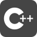

# Hello there, I'm Alexandre 👋🏻

### Data Science & Machine Learning Engineering

Exploring data science, machine learning, learning algorithms, neural networks, optimization, and model evaluation.

---

## About

I'm a Computer Engineering student focused on Data Science and Machine Learning, with particular interests in learning algorithms, neural networks, optimization, and model training and evaluation.

---

## Current Focus

- Data Analysis and Exploratory Data Analysis (EDA)
- Statistics and Computational Mathematics
- Machine Learning fundamentals
- Learning algorithms and neural networks
- Model training and evaluation
- Optimization
- Practical experimentation and model development

---

## Projects

### Machine Learning

> [!NOTE]  
> Projects coming as I progress through my ML studies and development.

### Previous Work

| Project     | Repository                                          | Status | Description                                                                    | Language     |
|:------------|:----------------------------------------------------|:-------|:-------------------------------------------------------------------------------|:-------------|
| **mkproj**  | [Public](https://github.com/avieira-dev/mkproj-cli) | Stable | Generate project structures from reusable templates.                           | **`Python`** |
| **ctxgen**  | [Public](https://github.com/avieira-dev/ctxgen)     | Stable | Bundle source code into a single text file for documentation and AI workflows. | **`Python`** |
| **dosh**    | [Public](https://github.com/avieira-dev/dosh)       | Active | A minimalist, lightweight terminal text editor focused on your needs           | **`Go`**     |
| **AtlasDS** |[Public](https://github.com/avieira-dev/atlas-ds)    | Active | Memory-oriented data structures library.                                       | **`C`**      |
| **binconv** | [Public](https://github.com/avieira-dev/binconv)    | Active | Command-line utility for numeral system conversion.                            | **`C`**      |

---

## Tech Stack

### Data Science & Machine Learning

  
  
  
  
  
  

### Databases

  
  

### Systems Programming

  
  
  
  

### Development Tools

  
  
  
  
  

### Currently Exploring

  

---

## Philosophy

I believe in learning through experimentation, critical thinking, and a deep understanding of the problems I aim to solve.

I value mathematical foundations, analytical reasoning, and practical implementation, seeking to understand not only how things work, but also why they work.

---

## Connect

